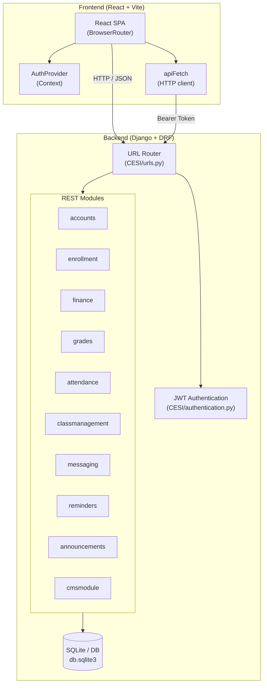
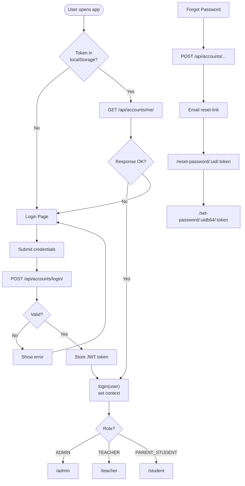
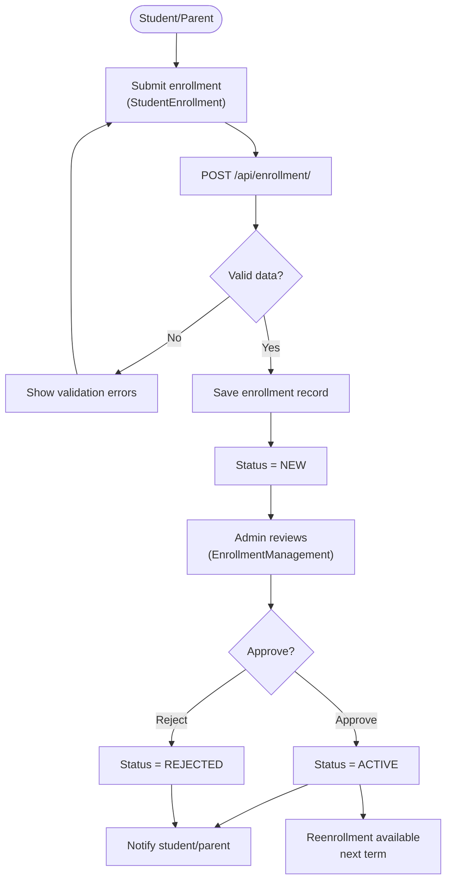
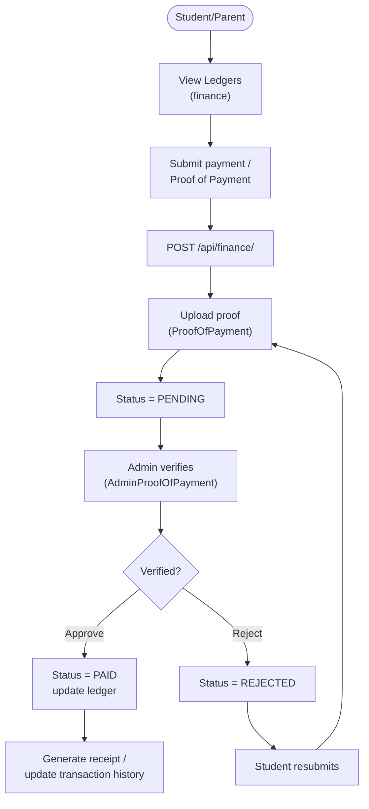
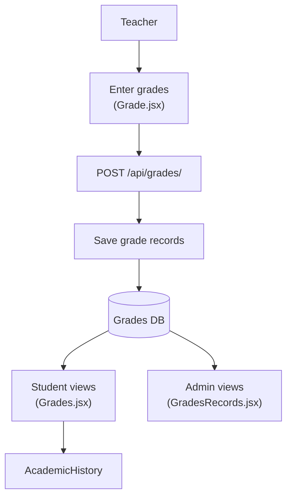
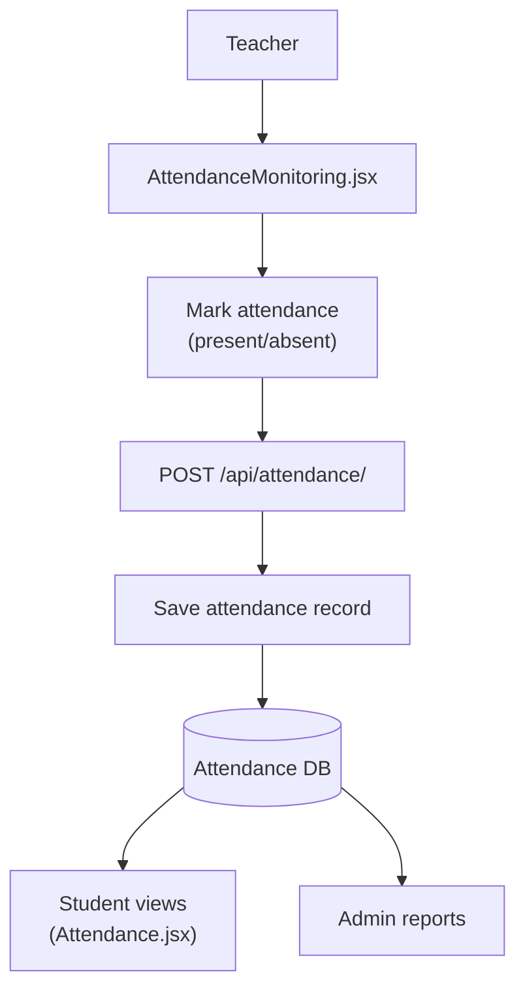
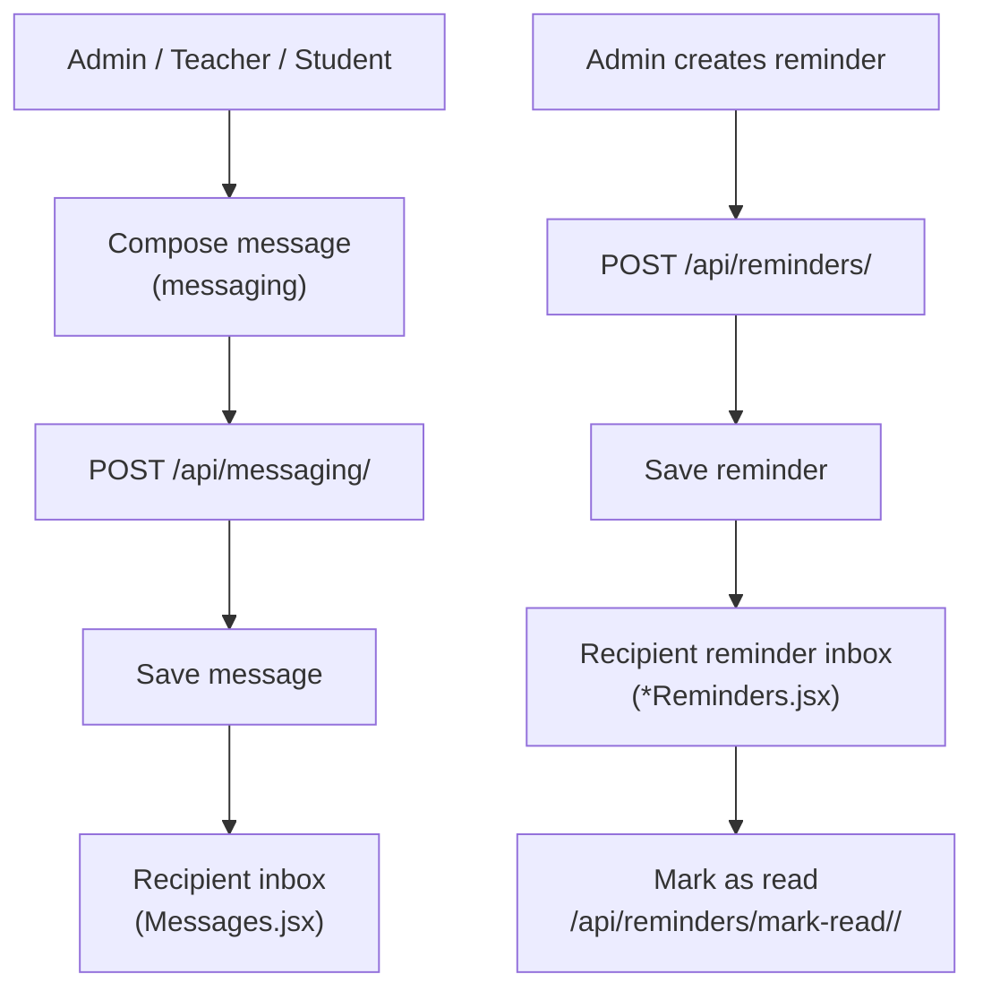
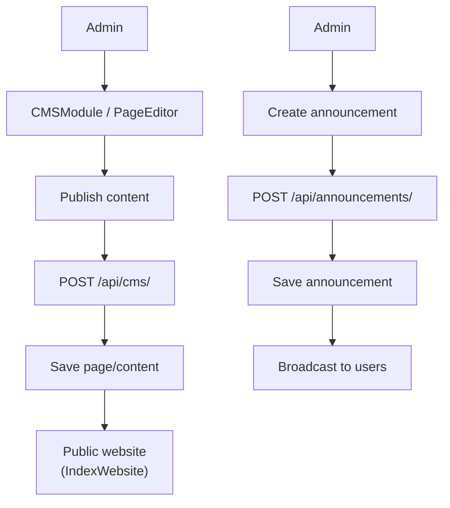
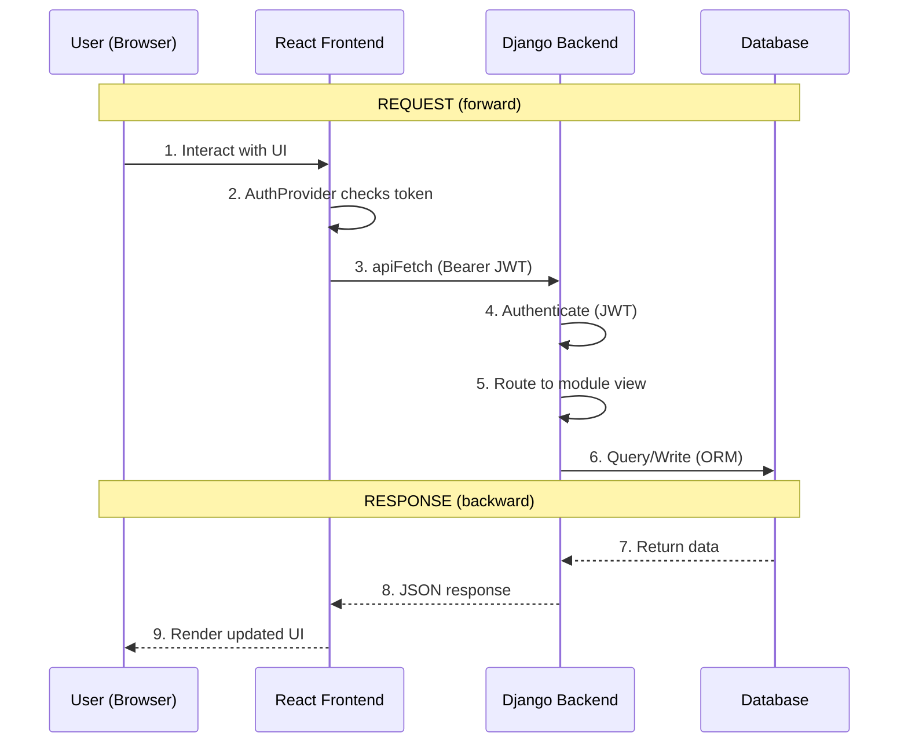

# CESI-3.1 — School Management System Flowchart

> Visual overview of the system architecture, authentication, role-based routing, and core business flows.

---

## 1. High-Level System Architecture

**Figure 1. High-Level System Architecture**

Figure 1 presents a comprehensive architectural overview of the CESI-3.1 School
Management System, illustrating the interaction between its two primary tiers. The
system is built upon a client-server model, where the frontend and backend
communicate exclusively through HTTP requests carrying JSON payloads.

- The **Frontend** is a React single-page application (SPA) that relies on
  `BrowserRouter` for navigation, an `AuthProvider` context for session state, and
  an `apiFetch` client for all network communication.
- The **Backend** is a Django application exposing a REST API through Django REST
  Framework. Incoming requests are first resolved by the URL router, then
  authenticated via JSON Web Tokens (JWT), and finally dispatched to the
  appropriate module.
- Ten distinct **REST modules** (`accounts`, `enrollment`, `finance`, `grades`,
  `attendance`, `classmanagement`, `messaging`, `reminders`, `announcements`, and
  `cmsmodule`) encapsulate the system's business logic, each persisting data to a
  shared SQLite database.

---

## 2. Authentication & Session Flow

**Figure 2. Authentication & Session Flow**

Figure 2 details the authentication lifecycle, from application launch through
successful role-based redirection. The flow governs how a user's identity is
established, validated, and maintained across sessions.

- Upon launch, the system checks for an existing token in `localStorage`. If
  present, it attempts to synchronize the session by calling
  `GET /api/accounts/me/`; a successful response restores the user context, while
  a failure redirects the user to the login page.
- The **login** path submits credentials to `POST /api/accounts/login/`. Valid
  credentials yield a JWT token that is stored locally and used to populate the
  user context; invalid credentials display an error and return to the form.
- Once authenticated, the user's **role** determines the destination dashboard:
  `ADMIN` is routed to `/admin`, `TEACHER` to `/teacher`, and `PARENT_STUDENT` to
  `/student`.
- A parallel **password recovery** path allows users to request a reset link,
  which leads through `/reset-password/:uid/:token` and
  `/set-password/:uidb64/:token` to establish a new password.

---

## 3. Role-Based Routing (Frontend)

```mermaid
flowchart TD
    Root["/ (Home)"] --> Login["/login"]
    Login --> Protected{ProtectedRoute<br/>role check}

    Protected -->|"role=ADMIN"| Admin["AdminDashboard"]
    Protected -->|"role=TEACHER"| Teacher["TeacherDashboard"]
    Protected -->|"role=PARENT_STUDENT"| Student["StudentMain"]

    Admin --> A1["UserManagement"]
    Admin --> A2["EnrollmentManagement"]
    Admin --> A3["TuitionManagement"]
    Admin --> A4["GradesRecords"]
    Admin --> A5["ClassManagement"]
    Admin --> A6["AssignTeachers"]
    Admin --> A7["CMSModule"]
    Admin --> A8["Reports"]
    Admin --> A9["PaymentReminders"]
    Admin --> A10["AdminProofOfPayment"]
    Admin --> A11["IdGenerator"]
    Admin --> A12["Messages"]

    Teacher --> T1["TeacherDashboard"]
    Teacher --> T2["AttendanceMonitoring"]
    Teacher --> T3["Grade"]
    Teacher --> T4["Students"]
    Teacher --> T5["TeacherClassSchedule"]
    Teacher --> T6["SPerformance"]
    Teacher --> T7["Messages"]
    Teacher --> T8["TeacherReminders"]

    Student --> S1["Dashboard"]
    Student --> S2["StudentEnrollment / Reenrollment"]
    Student --> S3["Grades"]
    Student --> S4["Attendance"]
    Student --> S5["Schedule"]
    Student --> S6["Ledgers"]
    Student --> S7["ProofOfPayment"]
    Student --> S8["AcademicHistory"]
    Student --> S9["Message"]
    Student --> S10["StudentReminders"]
    Student --> S11["Profile"]

    Protected -->|"No access"| Unauthorized["/unauthorized"]
```

**Figure 3. Role-Based Routing (Frontend)**

Figure 3 illustrates how the frontend dispatches authenticated users to their
respective workspaces based on role. A central `ProtectedRoute` component acts as
the gatekeeper, enforcing access control before any dashboard is rendered.

- Users arriving at the home page are directed to `/login`, after which the
  `ProtectedRoute` evaluates their role.
- **Administrators** gain access to twelve modules, including user management,
  enrollment management, tuition management, grade records, class management,
  teacher assignment, the CMS, reports, payment reminders, proof-of-payment
  verification, ID generation, and messaging.
- **Teachers** are presented with eight modules covering their dashboard,
  attendance monitoring, grade entry, student rosters, class schedules,
  performance tracking, messaging, and reminders.
- **Students/Parents** access eleven modules spanning their dashboard, enrollment
  and re-enrollment, grades, attendance, schedules, ledgers, proof of payment,
  academic history, messaging, reminders, and profile.
- Any user lacking the required role is redirected to the `/unauthorized` page.

---

## 4. Enrollment Flow

**Figure 4. Enrollment Flow**

Figure 4 traces the student enrollment process from initial submission through
administrative review. This flow ensures that every applicant is validated and
explicitly approved before becoming an active student.

- A student or parent submits an enrollment application through the
  `StudentEnrollment` interface, which posts the data to `POST /api/enrollment/`.
- The system validates the submission; invalid data returns validation errors for
  correction, while valid data is persisted with an initial status of `NEW`.
- An **administrator** reviews the pending record in `EnrollmentManagement` and
  renders a decision.
- Approval transitions the record to `ACTIVE`, whereas rejection sets it to
  `REJECTED`; in both cases the applicant is notified of the outcome.
- Active students become eligible for **re-enrollment** in subsequent terms.

---

## 5. Finance / Payment Flow

**Figure 5. Finance / Payment Flow**

Figure 5 outlines the payment and proof-of-payment verification workflow. The
process ensures that every financial transaction is substantiated and approved
before a ledger is updated.

- A student or parent first reviews their outstanding balance in the **Ledgers**
  view, then submits a payment accompanied by proof of payment.
- The submission is posted to `POST /api/finance/`, where the proof document is
  uploaded and the record is marked `PENDING`.
- An **administrator** verifies the proof in `AdminProofOfPayment`.
- Approved payments are marked `PAID` and update the ledger, generating a receipt
  and a transaction-history entry.
- Rejected payments are marked `REJECTED`, prompting the student to resubmit
  corrected proof.

---

## 6. Grades Flow

**Figure 6. Grades Flow**

Figure 6 depicts the grade-recording pipeline, from teacher entry to student and
administrator visibility. The flow centralizes grade data so that all authorized
parties read from a single source of truth.

- A **teacher** enters grades through the `Grade` interface, which posts the
  records to `POST /api/grades/`.
- The records are persisted to the grades database.
- **Students** retrieve their grades through the `Grades` view and can trace their
  cumulative performance in `AcademicHistory`.
- **Administrators** monitor grade records through `GradesRecords` for oversight
  and reporting.

---

## 7. Attendance Flow

**Figure 7. Attendance Flow**

Figure 7 illustrates the attendance-tracking workflow. It captures how daily
attendance is recorded by teachers and subsequently surfaced to students and
administrators.

- A **teacher** uses `AttendanceMonitoring` to mark each student as present or
  absent, submitting the results to `POST /api/attendance/`.
- The attendance records are saved to the attendance database.
- **Students** review their own attendance through the `Attendance` view.
- **Administrators** aggregate the data for reporting and monitoring purposes.

---

## 8. Messaging & Reminders Flow

**Figure 8. Messaging & Reminders Flow**

Figure 8 covers the system's two notification mechanisms: direct messaging and
reminders. Both follow a sender-to-recipient pattern, with reminders additionally
supporting a read-receipt lifecycle.

- Any user (admin, teacher, or student) may **compose a message**, which is posted
  to `POST /api/messaging/` and delivered to the recipient's inbox in `Messages`.
- An **administrator** may create a reminder via `POST /api/reminders/`, which is
  stored and delivered to the recipient's reminder inbox.
- Recipients can acknowledge a reminder by marking it as read through
  `/api/reminders/mark-read/<id>/`, completing the notification cycle.

---

## 9. CMS / Announcements Flow

**Figure 9. CMS / Announcements Flow**

Figure 9 describes how content and announcements are authored and published to the
wider user base. These flows enable administrators to control both the public-facing
website and in-app communications.

- Through the **CMS** (`CMSModule` / `PageEditor`), an administrator authors and
  publishes content, which is posted to `POST /api/cms/` and rendered on the
  public website (`IndexWebsite`).
- Separately, an administrator may create an **announcement** via
  `POST /api/announcements/`, which is saved and broadcast to all users.

---

## 10. End-to-End Request Lifecycle

**Figure 10. End-to-End Request Lifecycle**

Figure 10 presents a sequence diagram tracing a single request through every layer
of the system, from user interaction to rendered output. It clarifies the direction
of data flow in both the forward (request) and backward (response) phases.

- In the **request phase**, the user interacts with the UI, the frontend verifies
  the authentication token, and the request is dispatched to the backend via
  `apiFetch` with a Bearer JWT.
- The backend **authenticates** the token, routes the request to the appropriate
  module view, and issues a query or write against the database through the ORM.
- In the **response phase**, the database returns the data to the backend, which
  serializes it into a JSON response and sends it back to the frontend.
- Finally, the frontend **renders the updated UI** to the user, completing the
  round-trip.

---

## Summary of Modules

| Module | Purpose | Key Frontend Components |
|--------|---------|-------------------------|
| `accounts` | Users, roles, auth | `Login`, `SetPassword`, `ForgotPassword`, `ResetPassword` |
| `enrollment` | Student enrollment | `StudentEnrollment`, `EnrollmentManagement` |
| `finance` | Tuition, payments, ledgers | `Ledgers`, `ProofOfPayment`, `TuitionManagement`, `TransactionHistory` |
| `grades` | Grade records | `Grade`, `Grades`, `GradesRecords`, `AcademicHistory` |
| `attendance` | Attendance tracking | `AttendanceMonitoring`, `Attendance` |
| `classmanagement` | Classes, subjects, teachers | `ClassManagement`, `AssignTeachers`, `Subjects` |
| `messaging` | Internal messaging | `Messages`, `FloatingMessages` |
| `reminders` | Notifications/reminders | `PaymentReminders`, `TeacherReminders`, `StudentReminders` |
| `announcements` | Public announcements | `Home` (IndexWebsite) |
| `cmsmodule` | Content management | `CMSModule`, `PageEditor` |