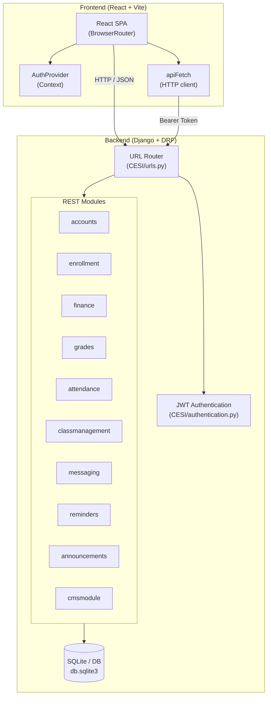
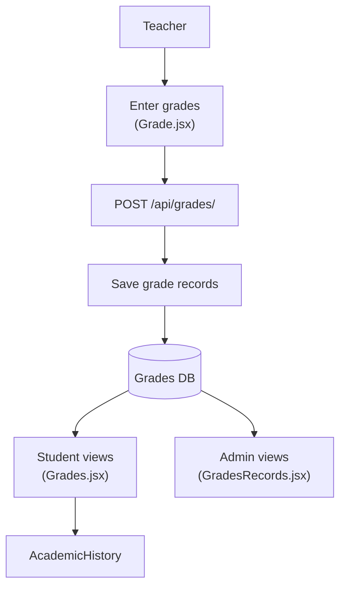
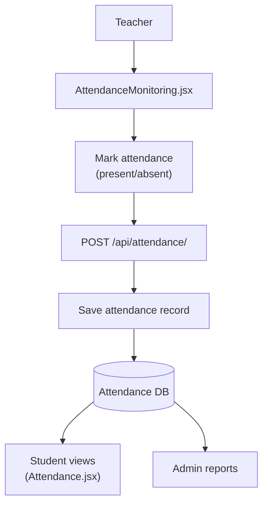
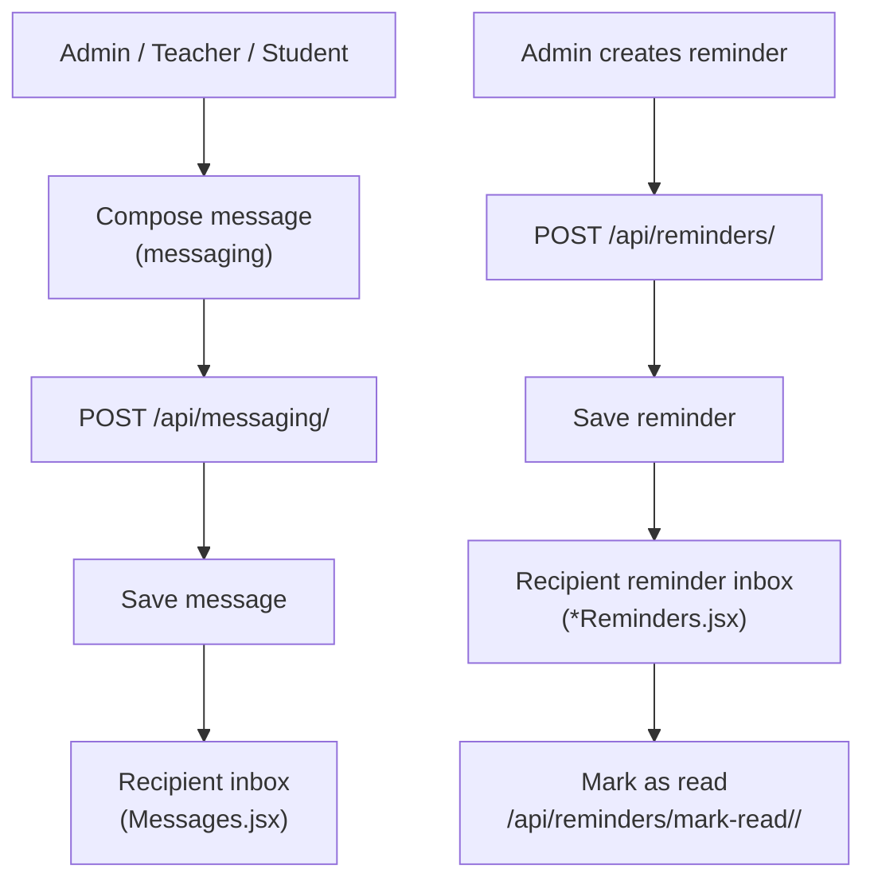
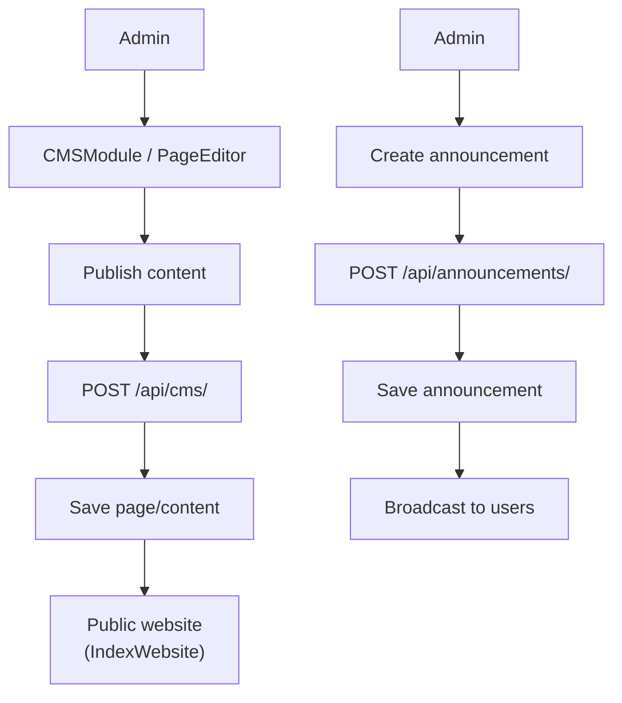
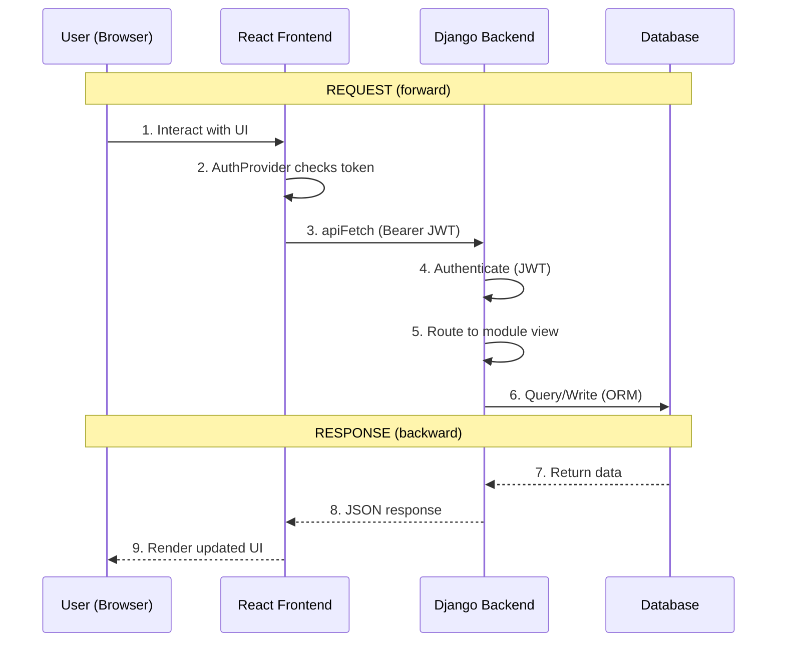

# CESI-3.1 — School Management System Flowchart

> Visual overview of the system architecture, authentication, role-based routing, and core business flows.

---

## 1. High-Level System Architecture

---

## 2. Authentication & Session Flow

---

## 3. Role-Based Routing (Frontend)

```mermaid
flowchart TD
    Root["/ (Home)"] --> Login["/login"]
    Login --> Protected{ProtectedRoute<br/>role check}

    Protected -->|"role=ADMIN"| Admin["AdminDashboard"]
    Protected -->|"role=TEACHER"| Teacher["TeacherDashboard"]
    Protected -->|"role=PARENT_STUDENT"| Student["StudentMain"]

    Admin --> A1["UserManagement"]
    Admin --> A2["EnrollmentManagement"]
    Admin --> A3["TuitionManagement"]
    Admin --> A4["GradesRecords"]
    Admin --> A5["ClassManagement"]
    Admin --> A6["AssignTeachers"]
    Admin --> A7["CMSModule"]
    Admin --> A8["Reports"]
    Admin --> A9["PaymentReminders"]
    Admin --> A10["AdminProofOfPayment"]
    Admin --> A11["IdGenerator"]
    Admin --> A12["Messages"]

    Teacher --> T1["TeacherDashboard"]
    Teacher --> T2["AttendanceMonitoring"]
    Teacher --> T3["Grade"]
    Teacher --> T4["Students"]
    Teacher --> T5["TeacherClassSchedule"]
    Teacher --> T6["SPerformance"]
    Teacher --> T7["Messages"]
    Teacher --> T8["TeacherReminders"]

    Student --> S1["Dashboard"]
    Student --> S2["StudentEnrollment / Reenrollment"]
    Student --> S3["Grades"]
    Student --> S4["Attendance"]
    Student --> S5["Schedule"]
    Student --> S6["Ledgers"]
    Student --> S7["ProofOfPayment"]
    Student --> S8["AcademicHistory"]
    Student --> S9["Message"]
    Student --> S10["StudentReminders"]
    Student --> S11["Profile"]

    Protected -->|"No access"| Unauthorized["/unauthorized"]
```

---

## 4. Enrollment Flow

---

## 5. Finance / Payment Flow

---

## 6. Grades Flow

---

## 7. Attendance Flow

---

## 8. Messaging & Reminders Flow

---

## 9. CMS / Announcements Flow

---

## 10. End-to-End Request Lifecycle

---

## Summary of Modules

| Module | Purpose | Key Frontend Components |
|--------|---------|-------------------------|
| `accounts` | Users, roles, auth | `Login`, `SetPassword`, `ForgotPassword`, `ResetPassword` |
| `enrollment` | Student enrollment | `StudentEnrollment`, `EnrollmentManagement` |
| `finance` | Tuition, payments, ledgers | `Ledgers`, `ProofOfPayment`, `TuitionManagement`, `TransactionHistory` |
| `grades` | Grade records | `Grade`, `Grades`, `GradesRecords`, `AcademicHistory` |
| `attendance` | Attendance tracking | `AttendanceMonitoring`, `Attendance` |
| `classmanagement` | Classes, subjects, teachers | `ClassManagement`, `AssignTeachers`, `Subjects` |
| `messaging` | Internal messaging | `Messages`, `FloatingMessages` |
| `reminders` | Notifications/reminders | `PaymentReminders`, `TeacherReminders`, `StudentReminders` |
| `announcements` | Public announcements | `Home` (IndexWebsite) |
| `cmsmodule` | Content management | `CMSModule`, `PageEditor` |